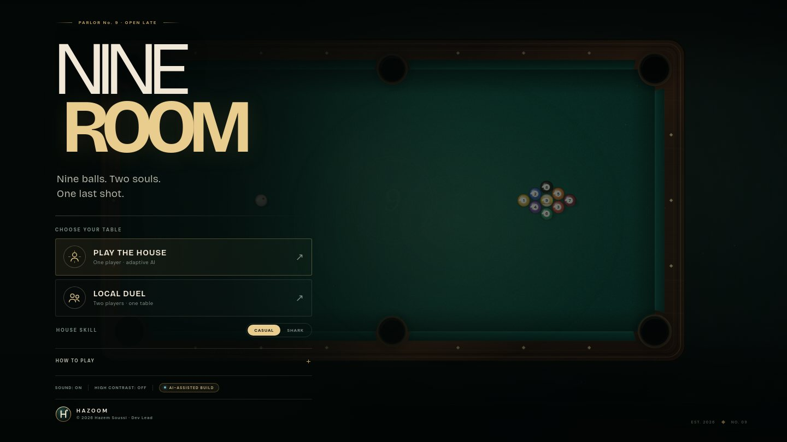

<p align="center">
  
</p>

<p align="center">
  
</p>

<h1 align="center">NINE ROOM — a nine-ball billiards salon for the browser</h1>

<p align="center">
  <strong>Play the House</strong> (adaptive AI opponent) or a <strong>Local Duel</strong> on one screen.<br>
  Custom fixed-step physics · hand-drawn canvas art · synthesized audio · zero runtime dependencies.
</p>

<p align="center">
  <a href="#features">Features</a> ·
  <a href="#how-it-works">How it works</a> ·
  <a href="#controls">Controls</a> ·
  <a href="#rules">Rules</a> ·
  <a href="#roadmap">Roadmap</a> ·
  <a href="#credits">Credits</a>
</p>

---

## Run it

No build step, no bundler, no dependencies. Clone and open:

```bash
git clone https://github.com/hazem-soussi-HA/nine-room.git
cd nine-room
python3 -m http.server 8080      # or: npx serve .
# open http://localhost:8080
```

It also runs straight from `file://` — the game is three files: `index.html`, `styles.css`, `game.js`.

## Features

| | |
|---|---|
| **Real billiards physics** | 240 Hz fixed-step simulation, momentum transfer, spin-free sliding friction, cushion restitution, pocket capture, throw and cut angles that behave like a real table. |
| **Nine-ball rules** | Lowest-ball-first, legal break, rail-after-contact, scratch handling, ball in hand, 9-ball respot on foul, three-foul rack forfeit. |
| **The House (AI)** | Plans pots by ray-casting every ball/pocket pair, evaluates cut angle, distance, obstruction and collision quality, banks off rails when a direct pot is blocked, plays safeties, and takes ball in hand. Two skill tiers. |
| **Aiming suite** | Ghost ball at contact point, object-ball tangent and cut line, rail-reflection preview, pocket highlight when the shot lines up, plus fine aim with arrow keys. |
| **Shot feel** | Hold to charge (pointer or space), power meter, cue pull-back, chalk burst, contact shadow, camera shake and slow-motion on the final ball. |
| **Synthesized audio** | Every sound is generated at runtime with the Web Audio API — break, ball clicks, cushion thuds, pocket drops, foul buzz, victory sting. No audio files. |
| **Interface** | Salon-grade menu, HUD with live rack tracker, pause / re-rack / leave, match stats, toasts, slow-motion tag, high-contrast mode, reduced-motion support, full keyboard control. |
| **Responsive** | Scales from 4K to a 900×620 window; the table re-frames instead of stretching. |

## How it works

```
nine-room/
├── index.html          # semantic markup: HUD, menu, pause & game-over overlays
├── styles.css          # design system: tokens, layout, motion, high-contrast theme
├── game.js             # the whole game — state, physics, rules, AI, renderer, audio
├── assets/             # HAZOOM brand marks (SVG)
├── docs/               # screenshots used by this README
└── favicon.svg
```

**Simulation.** The table is a fixed 1000 × 500 unit world (`R = 12.25` ball radius, 58-unit rails).
Every frame accumulates real time into a `1/240 s` fixed step, so physics is frame-rate independent:
`60 fps`, `120 fps` and a throttled tab all produce the same shot. Balls carry velocity, lose speed to
rolling resistance, bounce off cushions with restitution, transfer momentum on contact and are captured
by pockets with a capture radius larger than the jaw.

**Rules engine.** A shot records the first ball contacted, whether a cushion was hit after contact,
whether the cue ball was potted, and which balls dropped. From that, the resolver derives a legal/foul
verdict, awards the turn, hands out ball in hand, respots the 9 on a foul, and tracks foul streaks for
the three-foul forfeit.

**AI.** The House runs a small search rather than a scripted script: for every legal target ball it
casts rays to every pocket, scores the shot by cut angle, distance, obstruction and post-contact risk,
and falls back to a bank or a safety when no pot is available. It also models a player — it waits,
lines up, charges, and misses on purpose the way a human does.

**Rendering.** The table is drawn once into an offscreen canvas (wood grain, cloth noise, cushions,
pockets, brass sights), then blitted each frame; only the balls, cue, aim guides, particles and
lighting are drawn live. That keeps the 60 fps budget on mid-range hardware.

## Controls

| Input | Action |
|---|---|
| Move pointer | Aim |
| Hold pointer / <kbd>Space</kbd> | Charge the shot |
| Release | Strike |
| <kbd>←</kbd> <kbd>→</kbd> | Fine aim (hold <kbd>Shift</kbd> for extra fine) |
| Click (ball in hand) | Place the cue ball |
| <kbd>Esc</kbd> / <kbd>P</kbd> | Pause |
| <kbd>M</kbd> | Mute / unmute |

## Rules implemented

- Nine-ball: always contact the lowest-numbered ball first.
- A legal shot needs a rail (or a pocket) after contact; otherwise it is a foul.
- Any ball potted on a legal shot keeps you at the table; the 9 wins the rack when it is legal.
- Scratching the cue ball is a foul and gives the opponent ball in hand.
- The 9 is respotted on a foul; three consecutive fouls forfeit the rack.
- Break must drive four balls to a rail or pot a ball.

## Roadmap

- **Phase 2 — Feel:** cue elevation and english (follow / draw / stun), richer sliding friction, break tuning.
- **Phase 2 — Rules:** push-out after the break, 9-ball on the spot, stricter break validation.
- **Phase 2 — AI depth:** rookie / pro / shark tiers, positional play, deliberate fouls, shot-shape error model.
- **Phase 3 — Modes:** 8-ball, free practice table, online two-player via WebRTC, shot clock, last-shot replay.
- **Phase 4 — Ship polish:** performance pass, PWA manifest, accessibility audit, published build.

## Credits

**Dev Lead:** Hazem Soussi — product direction, game design, systems architecture, art direction.
**AI:** this build was engineered with AI pair-programming (agentic coding assistants) — physics
solver, rules engine, AI planner, renderer and audio synthesis — under the direction and review of
the dev lead.

<p align="center">
  
</p>

<p align="center"><sub>© 2026 HAZOOM — All rights reserved. MIT licensed.</sub></p>

## License

[MIT](LICENSE) © 2026 Hazem Soussi (HAZOOM)
